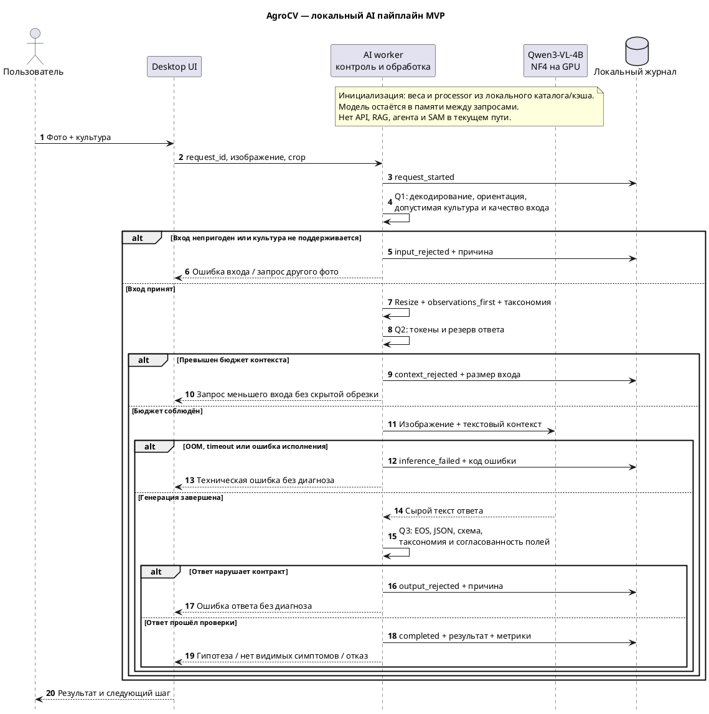

# Дизайн AI пайплайна AgroCV

## 1 Схема пайплайна

Один пользовательский запрос содержит одно фото листа и культуру, выбранную пользователем. Последовательность задаёт код приложения: модель не выбирает инструменты, не ищет документы и не управляет повторными вызовами. Это сохраняет предсказуемый объём вычислений и позволяет отдельно проверять каждый этап.

Стрелка к журналу обозначает локальную запись, а не отправку данных внешнему сервису. RAG не включён: справочник пока не требуется для выполнения запроса и сам по себе не подтверждает распознавание. Агент не нужен, поскольку порядок действий фиксирован. Основание: [выбор подхода и альтернативы](decision.md).

## 2 Вход, промпт и контракт ответа

**Вход:** `request_id`, одно изображение, `crop = apple | cherry`. Приложение декодирует фото, применяет EXIF-ориентацию, переводит в RGB и использует processor модели для resize. Предполагается один лист крупным планом; несколько листьев не означают поддержку индивидуальной диагностики каждого из них. Пользователю предлагается выбрать или переснять один лист.

**Контекст запроса:** системная инструкция → фото → `observations_first` → название культуры → разрешённые болезни → схема JSON. Системная инструкция требует описывать видимые признаки, допускает неопределённость и запрещает выдавать вероятность или назначать лечение. Эталонная метка и название файла в промпт не включаются.

Используется версия промпта из lab1 для сопоставимости. Известное ограничение: он просит сначала признаки, но шаблон ставит диагноз первым. Изменение порядка полей оформляется как новая версия и отдельное сравнение, а не как уже доказанное улучшение. Источник: [разбор промпта](experiments/lab1.md).

| Поле ответа | Проверка приложением |
|---|---|
| `status` | Только `no_visible_symptoms`, `suspected_disease`, `other_or_unknown`, `insufficient_image` |
| `disease` | При `suspected_disease` — один класс из таксономии выбранной культуры; иначе `null` |
| `observations` | До 3 объектов с непустыми строками `description` и `location` |
| `alternatives` | До 2 различных разрешённых классов, без повторения основной гипотезы |
| `next_photo` | Краткая строка либо `null` |

Неожиданные поля, обрезанный ответ или нарушение схемы дают `output_rejected`. Технические ошибки приложения хранятся отдельно от четырёх состояний листа: сбой CUDA не означает `insufficient_image`. В UI `no_visible_symptoms` отображается как «видимых симптомов не обнаружено», а `suspected_disease` — как предварительная гипотеза.

## 3 Точки контроля качества

| Точка | Что проверяется | Действие при проблеме |
|---|---|---|
| Q0 — старт worker | Локальные файлы, тип модели, версии, доступность CUDA, профиль NF4 | Диагностика конфигурации; без автоматической загрузки и облачного fallback |
| Q1 — вход | Декодирование, размеры, культура; признаки сильного размытия/засветки | Нечитаемый файл отклонить. Эвристики качества сначала использовать как предупреждение; пороги откалибровать на данных |
| Q2 — до генерации | Фактические токены после processor, резерв ответа, доступные ресурсы | Не запускать запрос сверх лимита; не обрезать молча таксономию или инструкции |
| Q3 — после генерации | Обрезка по лимиту, JSON и контракт, классы, противоречия полей | Сохранить ошибку; не показывать частичный ответ как диагноз |
| Q4 — проверка качества модели вне рабочего запроса | Соответствие признаков фото, правильность класса, ложное отсутствие симптомов, уместность отказа | Экспертная проверка независимого теста; решение о смене промпта/модели/разрешения |

**Валидный JSON не подтверждает диагноз.** Q3 проверяет форму и логическую согласованность, но не доказывает наличие пятен или возбудителя. Для Q4 нужны случаи обеих культур с подтверждёнными метками, включая здоровые, похожие нецелевые повреждения и плохие фото. Снимки одного дерева/серии не разделяются между обучением и тестом. Метрики: macro-F1, recall по классам, ошибки среди принятых ответов и доля отказов; критерии приёмки согласуются до оценки закрытого теста. Основание: [ресёрч](research.md), [границы lab1](experiments/lab1.md).

## 4 Лимиты и логирование

Для текущего профиля фиксируем: один запрос на GPU, одно изображение, 65 536–589 824 пикселя после обработки, до 384 новых токенов и `input_tokens + 384 ≤ 4096`. Визуальные токены уже входят во входные. Greedy-генерация, `do_sample=False`, seed 42. Модель остаётся загруженной, но контекст и KV-cache завершённого запроса между пользователями/случаями не переносятся.

384 токена соответствуют текущему ноутбуку; это уточнение ранней оценки с 256 токенами из [бюджета](models-and-budget.md). В lab1 получено 926 входных и 231 выходной токен — 1 157 на запрос. Измеренные 12,91 с прогретой обработки и 3,32 GiB allocated относятся только к тому примеру, а не к SLA. Источник: [lab1](experiments/lab1.md).

**На MVP — один вызов Qwen без автоматических повторов.** При OOM или превышении времени worker завершает задание с ошибкой и освобождает ресурсы; повтор запускает пользователь. Не переключаем незаметно модель, разрешение или CPU-offload. Предлагаемый timeout обработки — 120 с после готовности модели; загрузка имеет отдельный статус и таймер. Для жёсткого timeout нужен контроль отдельного процесса; в ноутбуке его пока нет. Три повтора сохраняются только в режиме эксперимента.

| Группа журнала | Обязательные данные |
|---|---|
| Связность | UTC-время, `request_id`, `attempt_id`, этап, статус и код ошибки |
| Вход | Культура, hash исходного и обработанного изображения, исходный размер, grid после resize, предупреждения качества |
| Версии | Checkpoint и commit, tokenizer/processor, квантование/dtype, параметры генерации, версии библиотек, GPU, версия кода |
| Контекст | Версии и hash промпта, таксономии и схемы; локальный снимок их точного содержимого для воспроизведения |
| Результат | Сырой ответ, разобранный JSON, результат каждой проверки, финальный статус, обрезка |
| Ресурсы | Входные/визуальные/выходные токены, время очереди/загрузки/подготовки/генерации, признак первого инференса, peak allocated/reserved |

Журналы ведутся локально для успешных и неуспешных запросов. Не писать абсолютные пользовательские пути и EXIF в обычный журнал. Исходные фото сохранять только при включённой истории/эксперименте; hash без файла не позволяет воспроизвести визуальную проверку. Коррекция эксперта хранится отдельно от первоначального предсказания и не запускает обучение автоматически. Постоянное логирование — требование MVP; текущий упрощённый ноутбук выводит результаты, но не реализует этот журнал целиком.

## 5 Границы контекста

| Модель видит | Модель не видит |
|---|---|
| Фото после ориентации и resize, включая сохранившийся фон | Исходную детализацию, потерянную при уменьшении; невидимую сторону листа |
| Культуру, указанную пользователем | Проверенное ботаническое определение культуры: правильность ввода не гарантирована |
| Разрешённые классы и текст текущего промпта | Полный перечень заболеваний, подтверждённую метку, диагноз эксперта и имя файла |
| Схему ответа и инструкции об отказе | Локальную историю, предыдущие ответы и другие фото, если они явно не переданы |
| Общие знания из весов | Актуальный справочник, интернет, RAG-корпус, лабораторные результаты, погоду и агрономический контекст |
| Пиксели листа в текущем кадре | Маски SAM, точную площадь поражения, состояние всего дерева и скрытые симптомы |

Текст на фото — часть входных данных, а не разрешение менять инструкции. Выход модели не исполняется как код, команда или вызов инструмента; в UI выводятся только разрешённые поля. Утверждение модели о прочитанном справочнике или проведённом анализе не является доказательством доступа к ним.

## 6 Границы следующих этапов

**SAM:** после сравнения полного кадра и кропов добавить выделение листа перед Qwen. SAM и Qwen выполняются последовательно с освобождением GPU; маска — средство выделения области, а не диагноз. **LoRA:** подключать только после анализа устойчивых ошибок и проверки на независимом тесте. **RAG:** рассматривать для справочных объяснений с указанием источников. **Агент:** только при появлении задачи, действительно требующей выбора действий. Эти компоненты не входят в стоимость и гарантии текущего пути. Основание: [decision.md](decision.md).
