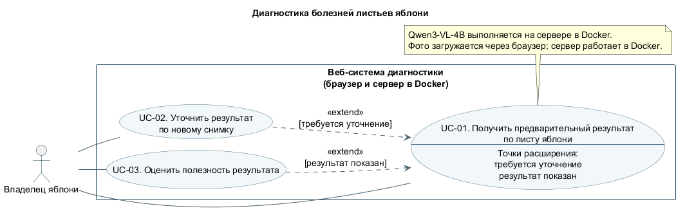

# Пользовательские сценарии

Актёр — **Владелец яблони**: начинающий садовод, выращивающий яблоки для личного потребления. Регистрация и аккаунт не требуются.

Исходник use-case диаграммы — [PlantUML: use-cases.puml](../diagrams/use-cases.puml). Представления того же исходника: [SVG](../diagrams/use-cases.svg) и [PNG](../diagrams/use-cases.png). Исходник содержит актёра, границу системы, три UC и связи `extend`; изображения служат для просмотра.

| ID | Цель | Основание |
| --- | --- | --- |
| UC-01 | [Получить предварительный результат по листу яблони](UC-01-assess-leaf.md) | P1–P3, P5: разобраться в изменениях листа и следующем шаге |
| UC-02 | [Уточнить результат по новому снимку](UC-02-refine-assessment.md) | P4: исправить непригодное фото или недостаточный ракурс |
| UC-03 | [Оценить полезность результата](UC-03-rate-usefulness.md) | P5: сообщить, помог ли ответ сориентироваться |

P1–P5 — проблемы проекта: неизвестная причина изменения листа; похожие примеры; противоречивые советы; непригодное фото; неясный следующий шаг. Все сценарии входят в MVP.

UC-02 расширяет UC-01 в точке «требуется уточнение», если владелец хочет переснять лист. UC-03 расширяет UC-01 в точке «результат показан», если владелец хочет оставить отзыв. Оба расширения необязательны. Стрелки на [диаграмме](../diagrams/use-cases.svg) не задают последовательность экранов.

Модель распознавания находится внутри системы; датасеты используются вне пользовательского запроса. Поэтому модель и датасеты не изображены внешними актёрами. При появлении внешнего сервиса распознавания границы и диаграмма должны быть пересмотрены.

Общие проверки, ограничения файлов и состав результата: [acceptance.md](../acceptance.md). Самостоятельный прогон заявлен владельцем яблонь из команды; независимый внешний прогон не зафиксирован. Протокол — [walkthrough.md](../walkthrough.md).

